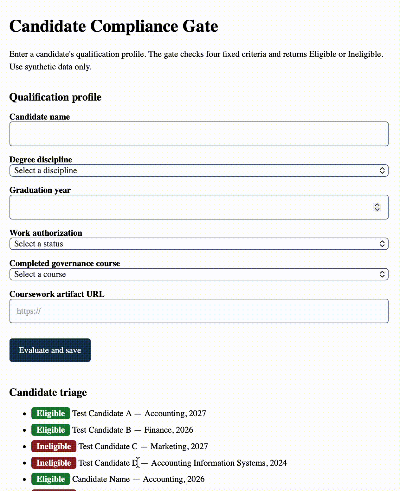

# Candidate Compliance Gate: Entry-Level Accounting & Finance Triage

## What
An edge-authoritative qualification gate that automates initial compliance triage for entry-level accounting and finance candidates against four fixed knockout criteria: degree discipline, graduation year, work authorization, and governance coursework completion. It prevents unvalidated applicant records from reaching the storage tier by executing deterministic screening logic at the Cloudflare edge runtime before persisting state to Cloudflare D1.

## Who It Is For
* **Campus Recruiters & Hiring Managers:** Eliminates manual resume scanning for non-negotiable compliance rules, providing an immediate triage audit trail with explicit pass/fail rationale for every candidate.
* **Student Applicants:** Delivers instant, transparent feedback on qualification status and explicitly names any unmet criteria without exposing internal server exceptions or stack traces.

## Team

| Member | Phase 1 role | Phase 2 role | Phase 3 role |
|---|---|---|---|
| **Kanyaab Cornett** | Implementer | Specifier | Withdrew from course |
| **Kenneth Riley II** | Specifier | Architect | Architect & Implementer |
| **Rishi Ajith** | Architect | Reviewer | Withdrew from course |
| **Regina Choi** | Reviewer | Implementer | Specifier, Reviewer, & Evaluator |

Governance, RACI matrix, and team rotation history: [TEAM.md](TEAM.md).

## Status
* **Phase 1:** Established problem boundaries, candidate user personas, and EARS acceptance criteria for knockout triage.
* **Phase 2:** Architected the unified Cloudflare Worker runtime, D1 relational database schema, and ADR-002 edge validation contracts.
* **Phase 3:** Deployed production edge Worker and remote D1 database, authored clean-checkout runbook (DEPLOY.md), verified 4/4 automated tests, and compiled cross-phase retrospectives and AI delegation logs.
* **Incomplete Scope & Limitations:** The production gate relies entirely on self-reported form selections and treats the coursework artifact URL as passive string metadata rather than inspecting or verifying submitted workpapers. Due to mid-semester team restructuring down to two members, the Riskiest Assumption Test (RAT) was not executed with external students and is honestly recorded as untested (0 student interviews completed). Performance/attractive features F-04 through F-06 remain unbuilt.

## See It Work

* **Presentation:** [Phase 3 Final Walkthrough Video](https://youtu.be/z2fPeVf547c)
* **Deployed URL:** https://team-beta-screening.kdotll.workers.dev

Enter a candidate profile and press **Evaluate and save**. The edge screening engine validates the four criteria at the Worker tier, presents a green **Eligible** badge or red **Ineligible** badge with unmet criteria, and appends the persistent record to the triage audit table from Cloudflare D1.

### Production Triage UI & Verification

## Build Status

| Feature | Class | State | Evidence |
|---|---|---|---|
| F-01 Accounting Compliance Knockout Gate | Must-be | Deployed | Smoke tests pass in `test/eligibility.test.js`, live checks verified in [DDR-004](docs/DDR-004.md) |
| F-02 Strict Verification Schema & Error Gate | Must-be | Deployed | 400 JSON validation errors verified live in [DDR-004](docs/DDR-004.md) |
| F-03 Edge Relational Audit Persistence (D1) | Must-be | Deployed | POST 201 and GET /entries verified live in [DDR-004](docs/DDR-004.md) |
| F-04 to F-06 Advanced Analytics & Verification | Performance / Attractive | Not built | Documented in [RETRO.md](docs/RETRO.md) and [EVALS.md](context/EVALS.md) |

Automated test verification:
`npm test` (Node 18 or later; passes 4/4 automated unit tests).

Deployment command sequence (see [docs/DEPLOY.md](docs/DEPLOY.md)):
`npx wrangler d1 execute mgt3745-dev --remote --file=schema.sql`
`npx wrangler d1 execute mgt3745-dev --remote --file=seed.sql`
`npx wrangler deploy`

## Links, in Reading Order

1. [TEAM.md](TEAM.md): Team roster, RACI assignments, and rotation history.
2. [docs/DEPLOY.md](docs/DEPLOY.md): Clean-checkout runbook and stranger deployment verification.
3. [docs/DACI-001.md](docs/DACI-001.md): Problem selection and architectural decision rights.
4. [context/PROJECT.md](context/PROJECT.md): Project charter, scope boundaries, and reframing.
5. [context/USERS.md](context/USERS.md): Candidate and recruiter personas and workflows.
6. [context/FEATURES.md](context/FEATURES.md): EARS functional requirements and Kano classification.
7. [docs/PROBE-001.md](docs/PROBE-001.md): Rapid prototype spike and Bolt.new evaluation.
8. [context/ARCHITECTURE.md](context/ARCHITECTURE.md): System architecture, ADR-001, ADR-002, and D1 relational schema.
9. [context/EVALS.md](context/EVALS.md): Reviewer and Evaluator judgment evals and prediction stakes.
10. [docs/RETRO.md](docs/RETRO.md): Team retrospective, RAT results, and evidence audit.
11. [docs/retro/kenneth-riley.md](docs/retro/kenneth-riley.md): Individual retrospective for Kenneth Riley II (Architect & Implementer).
12. [docs/retro/regina-choi.md](docs/retro/regina-choi.md): Individual retrospective for Regina Choi (Specifier, Reviewer, & Evaluator).
13. [docs/DDR-LOG.md](docs/DDR-LOG.md): Cross-phase delegation log and cumulative AI hour accounting.
14. [context/CLAUDE.md](context/CLAUDE.md), [context/STANDARDS.md](context/STANDARDS.md), [context/TOOLS.md](context/TOOLS.md): Operational standards and tool configurations.
15. [context/STYLE.md](context/STYLE.md), [context/SKILLS.md](context/SKILLS.md): Code conventions and team capability index.

## AI Use

* **Specification Probing & Gap Identification:** Delegated to bolt.new (Claude 3.5 Sonnet) as documented in [docs/DDR-001.md](docs/DDR-001.md).
* **Standards & Policy Drafting:** Drafted with assistance from Claude 3.5 Sonnet and Gemini, reviewed and owned by Kanyaab Cornett in PR #1.
* **Phase 3 Scaffold Pruning & Retro Polishing:** Delegated by Regina Choi to Claude 3.5 Sonnet (docs/DDR-005.md) and ChatGPT (docs/DDR-006.md)
* **Phase 3 Runbook & Retro Drafting:** Delegated structural drafting, CLI troubleshooting, and copyediting for DEPLOY.md and kenneth-riley.md to Google Gemini (Gemini 2.5 Pro) as documented in [docs/DDR-007.md](docs/DDR-007.md). All deployment operations, database migrations, and testing were manually executed by Kenneth Riley II in PR #30.
* **Comprehensive AI Accounting:** Every AI delegation across all three phases is logged with model version, hours, trust boundaries, and human verification in [docs/DDR-LOG.md](docs/DDR-LOG.md).